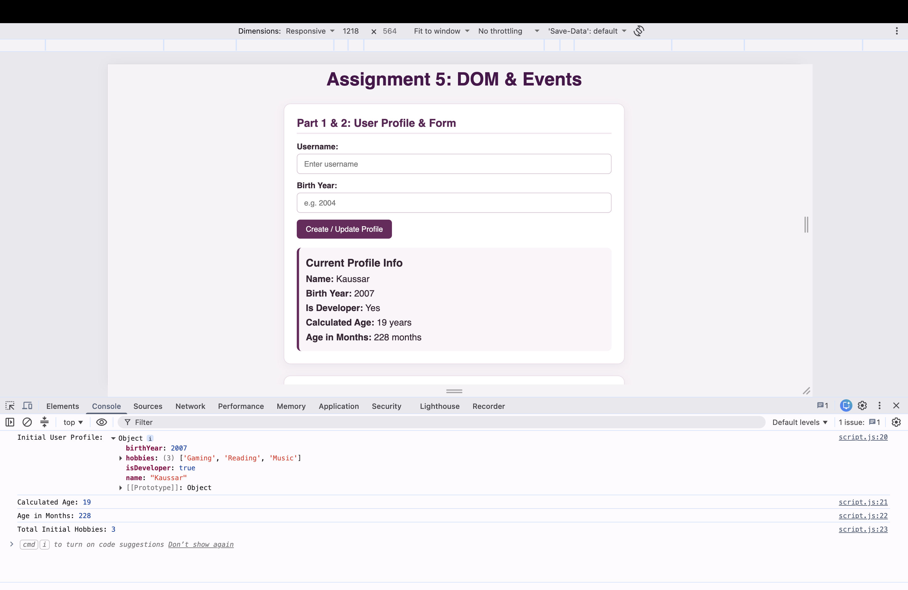
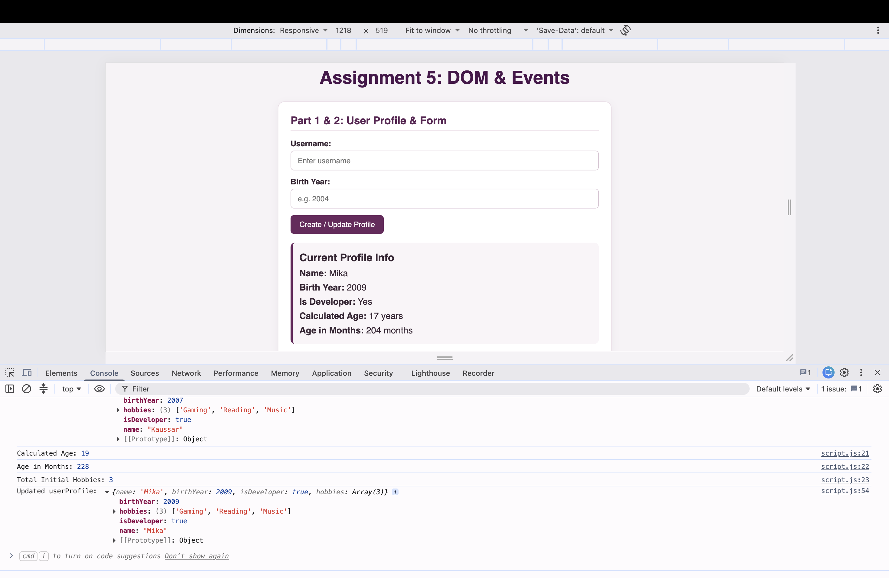
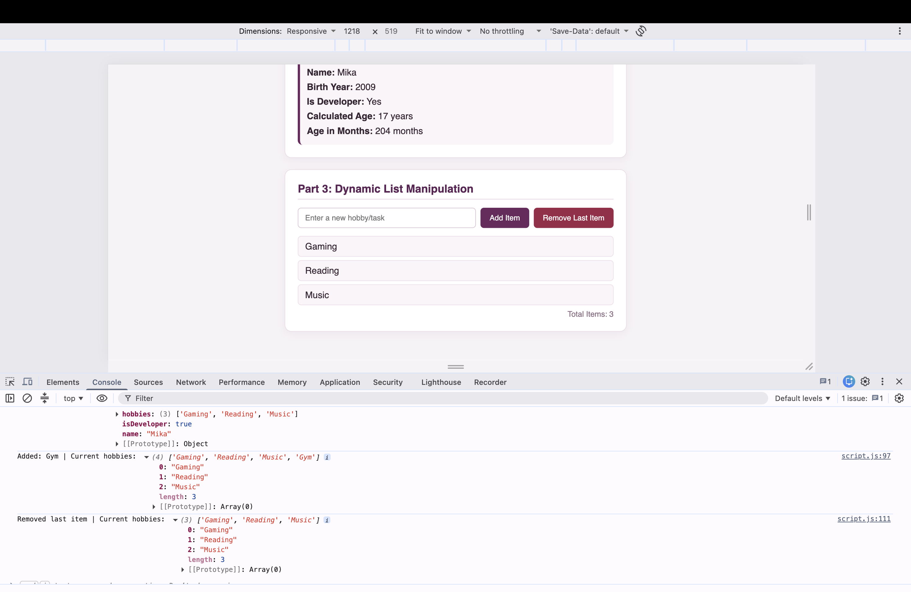

# Assignment 5: JavaScript Basics (DOM Manipulation & Events)

Name: Kaussar Meirambekkyzy Group: IT-2513

Link:

---

## Part 1: Profile Object, Data Types & Arithmetic

In this task, I created a 'userProfile' object that stores different data types: string for name, number for birth year, boolean for developer status, and an array for hobbies. I also wrote a script to calculate my current age dynamically using 'new Date().getFullYear()', calculated my age in months, and printed all values to the console.

Console output:

---

## Part 2: Form Input & Event Responses

In this part, I set up an HTML form with input fields for username and birth year. I added a submit event listener to the form and used 'event.preventDefault()' so the page doesn't reload. When the form is submitted, it updates the 'userProfile' object and dynamically changes the profile information displayed on the page.

Form update:

---

## Part 3: DOM List Manipulation

In this task, I created an unordered list ('<ul>') for hobbies/tasks. I added an "Add Item" button that takes text from the input field, creates a new '<li>' element using 'document.createElement', and appends it to the list. I also added a "Remove Item" button to delete the last element from the list using 'removeChild', and kept track of the total item count.

List manipulation:

---

## Summary of Work Process

During this assignment, I practiced basic JavaScript syntax, object manipulation, and event handling with 'addEventListener'. I learned how to prevent default form submission behavior, dynamically update DOM text content, and create or remove HTML elements using DOM methods. Everything was tested in the browser console and verified on the page.